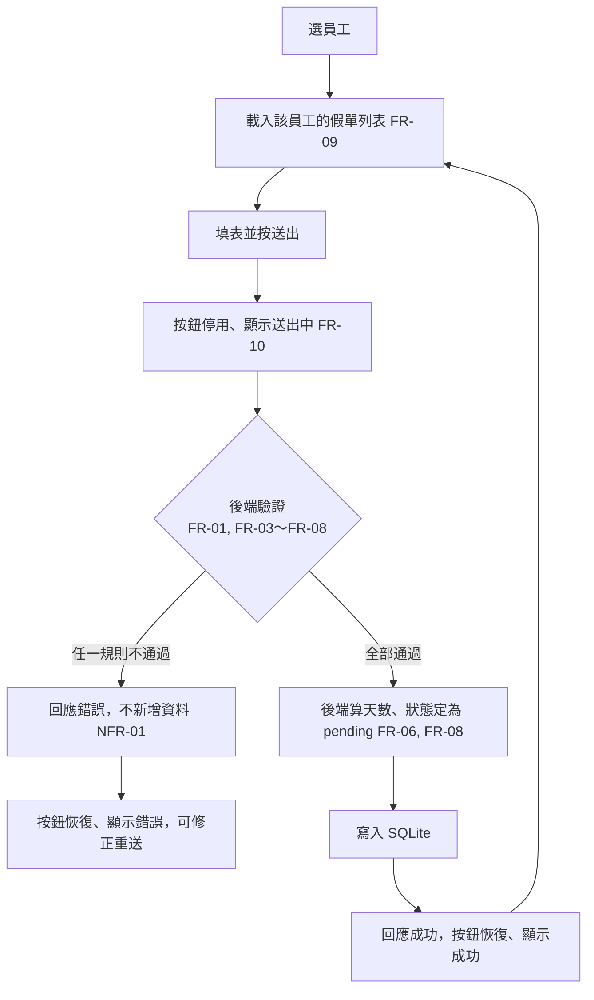

# 03 SRS — LeaveBot 請假系統

> 版本：v0.3｜負責人：ChristingChang（小組）｜日期：2026-10-28｜狀態：草稿（核心規則已定，待講師審查）｜審查者：講師（待審）
> 變更：v0.2 依小組決定寫入 Q-1（理由字數算法）與 Q-3（客戶端附帶狀態或天數時整筆拒絕），更新 FR-07、FR-08、規則字典與邊界例子 E18～E23。
> 變更：v0.3 卡 E 前小組定案 Q-2、Q-4～Q-10，更新 FR-01、FR-03、FR-09、FR-10、員工欄位，新增邊界例子 E24、E25。
> 上游：`docs/02-prd.md`（AC-01.1～AC-03.1、產品規則表、Q-1～Q-6）、`docs/01-brief.md`（D-1～D-3）、`course/01-上課/03-LEAVEBOT.md`。
> 例子的日期都已核對過星期幾。本檔只定義系統行為；欄位名稱、API 路徑與錯誤碼留給 SDS。

## 功能需求

| ID | 可觀察的系統行為 | 來源 AC |
|---|---|---|
| FR-01 | 系統提供預先寫入的固定員工名單供選擇（Q-2）；送出假單時，後端只接受名單內的員工，否則拒絕且不新增資料 | AC-01.1、AC-03.1；PRD 規則表「員工不存在」 |
| FR-02 | 收到合法申請時新增一筆假單，回應成功並帶回這筆假單的日期、天數與狀態；開始日期早於今天也照常受理 | AC-01.1、AC-01.2、AC-01.3 |
| FR-03 | 員工、假別、開始日期、結束日期、時段任一缺漏、或值不在允許範圍內時拒絕，錯誤指出是哪個欄位，不新增資料；請求含未定義的欄位時同樣拒絕（Q-10）；違反多條規則時一次回報全部錯誤（Q-7） | AC-02.1；PRD 規則表「假別或時段不在允許值內」 |
| FR-04 | 結束日期早於開始日期時拒絕，錯誤指出日期順序，不新增資料；兩者相同視為合法 | AC-02.2 |
| FR-05 | 時段為上午或下午、但開始與結束不是同一天時拒絕，錯誤指出半天假只能選同一天，不新增資料 | AC-02.3 |
| FR-06 | 天數由後端計算：只計週一至週五；整天每個工作日 1 天，上午／下午 0.5 天；工作日數為 0 時拒絕，錯誤指出區間內沒有工作日，不新增資料 | AC-01.1、AC-01.2、AC-01.3、AC-02.4 |
| FR-07 | 理由可留空；去掉頭尾空白後超過 200 字時拒絕，錯誤指出上限，不新增資料；保存去掉頭尾空白後的文字，顯示時不渲染為 HTML、不執行 | AC-01.1、AC-02.5；PRD 規則表「理由含 HTML」 |
| FR-08 | 新假單的狀態一律存為 `pending`，天數一律存為 FR-06 算出的值；請求若附帶狀態或天數欄位，整筆拒絕，錯誤指出這兩個欄位不能由客戶端指定，不新增資料 | AC-01.1、AC-01.2、AC-01.3；PRD Q-3 |
| FR-09 | 依所選員工列出其全部假單，最新送出的在最前；每筆含假別、日期、時段、天數、狀態、理由（Q-9）；沒有假單時顯示「目前沒有假單」（Q-4）；不含其他員工的假單；資料存於伺服器，重新整理或重啟服務後仍在 | AC-01.1、AC-03.1 |
| FR-10 | 未選員工時送出按鈕停用並提示「請先選擇員工」（Q-6）；送出請求期間，送出按鈕停用並顯示送出中，不會發出第二個請求；收到回應後恢復可用，並顯示成功或錯誤訊息；失敗時保留表單內容，成功時清空表單但保留所選員工（Q-5）。後端不比對重複，相同內容再送會存成另一筆 | AC-01.4 |

FR 合計 10 條（上限 10）。

## 規則與資料字典

主流程只有一條：選員工 → 填表 → 後端依下列規則逐項驗證 → 全部通過才寫入 SQLite → 列表重新讀取。任何一條規則不通過，整筆申請就被拒絕，資料庫不新增也不修改任何資料（共同拒絕規則，FR-01、FR-03～FR-08）。

### 欄位

| 欄位 | 誰決定 | 合法值與規則 | 缺漏或無效時 |
|---|---|---|---|
| 員工（FR-01、FR-03） | 使用者選 | 必須是員工名單內的一位；名單為預先寫入的固定員工（Q-2，內容見 SDS） | 拒絕，指出員工欄位 |
| 假別（FR-03） | 使用者選 | 只有 `annual`（特休）、`personal`（事假）、`sick`（病假）；大小寫須完全一致 | 缺漏或其他值都拒絕，指出假別欄位 |
| 開始日期、結束日期（FR-03、FR-04） | 使用者填 | 不帶時間與時區的日曆日期（年-月-日）；不存在的日期（例如 2026-02-30）視為無效；不以「今天」限制，過去日期合法（D-2）；不設上下限（Q-8） | 拒絕，指出哪個日期欄位 |
| 時段（FR-03、FR-05） | 使用者選 | 只有整天、上午、下午三種 | 缺漏或其他值都拒絕，指出時段欄位 |
| 理由（FR-07） | 使用者填 | 選填；長度 0～200 字（D-1）；上限只在一處定義（Brief R-3）。字數算法（Q-1）：先去掉頭尾空白（含全形空白），再以字元數計算，中文、全形、半形每個字都算 1；只含空白的理由視為未填，存成空字串；保存去掉頭尾空白後的文字 | 超過上限即拒絕，指出最多 200 字 |
| 天數（FR-06、FR-08） | **伺服器算** | 見下方算法 | 請求中出現此欄位，不論值為何都整筆拒絕（Q-3） |
| 狀態（FR-08） | **伺服器定** | 新假單固定 `pending`（畫面顯示「待審核」） | 請求中出現此欄位，不論值為何（包括 `pending`）都整筆拒絕（Q-3） |

### 天數算法（FR-06）

- 工作日＝週一至週五。日期區間包含首尾兩天。國定假日不排除（Brief NG-03），例如 2026-10-10（六）本來就是週末。
- 整天：天數＝區間內的工作日數 × 1。
- 上午／下午：開始與結束必須是同一天（FR-05），且這天要是工作日；天數＝0.5。
- 工作日數為 0 就拒絕（FR-06）。這包括半天假選在週六或週日。

### 決策表與邊界例子

今天固定為 2026-10-12（週一）。表中每列只違反一條規則，或完全合法。

| # | 開始 | 結束 | 時段 | 結果 | 天數／錯誤 | 驗證的規則 |
|---|---|---|---|---|---|---|
| E1 | 10-16（五） | 10-19（一） | 整天 | 成功 | 2（扣週六、日） | FR-06 扣週末；AC-01.1 |
| E2 | 10-13（二） | 10-13（二） | 上午 | 成功 | 0.5 | FR-05、FR-06；AC-01.2 |
| E3 | 10-05（一） | 10-05（一） | 整天 | 成功 | 1 | FR-02 過去日期；AC-01.3 |
| E4 | 10-13（二） | 10-13（二） | 整天 | 成功 | 1 | FR-04 首尾同日為合法邊界 |
| E5 | 10-12（一） | 10-25（日） | 整天 | 成功 | 10 | FR-06 跨兩個週末 |
| E6 | 10-20（二） | 10-19（一） | 整天 | 拒絕 | 結束早於開始 | FR-04；AC-02.2 |
| E7 | 10-13（二） | 10-14（三） | 下午 | 拒絕 | 半天假只能選同一天 | FR-05；AC-02.3 |
| E8 | 10-17（六） | 10-18（日） | 整天 | 拒絕 | 區間內沒有工作日 | FR-06；AC-02.4 |
| E9 | 10-17（六） | 10-17（六） | 上午 | 拒絕 | 區間內沒有工作日 | FR-05＋FR-06 半天須為工作日 |

其他欄位邊界：

| # | 輸入 | 結果 | 驗證的規則 |
|---|---|---|---|
| E10 | 未填假別，其餘合法 | 拒絕，指出假別 | FR-03；AC-02.1 |
| E11 | 假別 `vacation` 或 `Annual` | 拒絕，指出假別 | FR-03 |
| E12 | 員工不在名單 | 拒絕，指出員工 | FR-01 |
| E13 | 理由為空字串 | 成功 | FR-07；AC-01.1 |
| E14 | 理由為 200 個半形英文字母 `a`（無空白） | 成功 | FR-07 上限邊界；AC-02.5 |
| E15 | 理由為 201 個半形英文字母 `a`（無空白） | 拒絕，指出最多 200 字 | FR-07；AC-02.5 |
| E16 | 理由為 `<b>x</b>`，其餘合法 | 成功；列表顯示的文字就是 `<b>x</b>`，沒有變粗體 | FR-07 純文字 |
| E17 | 甲、乙各有 1 筆，查甲 | 只回甲的 1 筆 | FR-09；AC-03.1 |
| E18 | 理由為 200 個中文字「假」 | 成功 | FR-07 中文算 1 字（Q-1） |
| E19 | 理由為 201 個中文字「假」 | 拒絕，指出最多 200 字 | FR-07（Q-1） |
| E20 | 理由為 2 個半形空白＋200 個 `a`＋2 個全形空白 | 成功；存下的理由是 200 個 `a` | FR-07 頭尾空白不計（Q-1） |
| E21 | 理由只有 3 個全形空白 | 成功；存下的理由是空字串 | FR-07 只含空白視為未填（Q-1） |
| E22 | 合法假單另附狀態 `approved` | 拒絕，指出狀態不能指定；筆數不變 | FR-08（Q-3） |
| E23 | 合法假單另附天數 `2`（與系統算出的值相同） | 拒絕，指出天數不能指定；筆數不變 | FR-08（Q-3） |
| E24 | 合法假單另附未定義欄位 `foo` | 拒絕，指出 `foo` 不被接受；筆數不變 | FR-03（Q-10） |
| E25 | 未填假別，且開始 10-20、結束 10-19、整天 | 拒絕，同時指出缺少假別與結束早於開始；筆數不變 | FR-03、FR-04（Q-7） |

字數以 Unicode 字元計算。由多個字元組成的表情符號（例如帶膚色的 emoji）可能被算成 2 字以上，本次接受這個限制。

## 品質需求

- **NFR-01｜拒絕不留資料：** 每一個拒絕案例前後，假單總筆數相同，重新查詢列表也沒有新增。驗證：拒絕類 TC 都在 API 層比對送出前後的筆數。
- **NFR-02｜輸入安全：** 理由含 HTML 標籤或 SQL 片段（例如 `'); DROP TABLE x;--`）時，資料照原樣存入並以純文字顯示，資料表不受影響。驗證：自動化測試存入後讀回內容相同；人工在瀏覽器確認畫面顯示原樣文字。
- **NFR-03｜持久性：** 停止並重新啟動服務後，先前的假單仍可在列表查到。驗證：人工操作一次（04-STACK「Ctrl+C 停止後重啟一次」）。
- **NFR-04｜錯誤可理解：** 每個拒絕回應都能讓使用者看出是哪個欄位或哪條規則出錯，並以中文顯示在畫面上，而不是只顯示錯誤代碼。驗證：自動化測試檢查回應中錯誤所指的欄位或規則；人工操作至少一條拒絕路徑並截圖。
- **NFR-05｜可重現測試：** 測試使用暫存資料庫，不讀寫開發資料庫；需要「今天」時以固定日期注入。驗證：跑完測試後，開發資料庫的筆數與修改時間都不變。主線規則目前不依賴「今天」（D-2），固定時鐘只用於 AC 的情境描述。
- **NFR-06｜效能：待量測。** 沒有使用量或回應時間的依據，本次不訂門檻。
- **不適用：** 登入與權限（Brief NG-01）、多人同時編輯同一筆資料（目前沒有編輯功能）、高可用與部署（NG-06）。

## 流程與未決事項

### 待決事項

這裡沿用 PRD 的 Q 編號。新發現的問題從 Q-7 起編。

| ID | 問題 | 影響 | 決策人／期限 |
|---|---|---|---|
| Q-1 | **已決（2026-10-28 小組）** 理由字數算法：去掉頭尾空白後以字元計，每字算 1；只含空白視為未填 | FR-07；E18～E21 | — |
| Q-2 | **已決（2026-10-28 小組）** 員工名單：SQLite 員工表加固定種子資料，不提供管理介面 | FR-01；SDS 種子員工 | — |
| Q-3 | **已決（2026-10-28 小組）** 客戶端附帶狀態或天數：整筆拒絕，不存檔 | FR-08；E22、E23 | — |
| Q-4 | **已決（2026-10-28 小組）** 列表最新送出在最前；空狀態顯示「目前沒有假單」 | FR-09 | — |
| Q-5 | **已決（2026-10-28 小組）** 失敗保留表單；成功清空表單但保留所選員工 | FR-10 | — |
| Q-6 | **已決（2026-10-28 小組）** 未選員工時停用送出並提示「請先選擇員工」；後端仍拒絕缺員工 | FR-10、FR-03 | — |
| Q-7 | **已決（2026-10-28 小組）** 一次回傳全部錯誤清單 | FR-03；E25；SDS 錯誤格式 | — |
| Q-8 | **已決（2026-10-28 小組）** 日期不設上下限，列為範圍外 | FR-04 | — |
| Q-9 | **已決（2026-10-28 小組）** 列表也顯示假別與時段（中文） | FR-09 | — |
| Q-10 | **已決（2026-10-28 小組）** 一律拒絕未定義欄位 | FR-03；E24 | — |

Q-1～Q-10 已全數定案。本檔待講師審查後改為已確認。

> 審查重點：每條 AC 可追到 FR／NFR；需求不互相矛盾；合法、非法、邊界與持久副作用可判定；設計與測試者可獨立算出預期結果。
