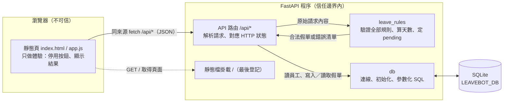

# 04 SAD — LeaveBot 請假系統

> 版本：v0.1｜負責人：ChristingChang（小組）｜日期：2026-10-28｜狀態：草稿（待講師審查）｜審查者：講師（待審）
> 上游：`docs/02-prd.md`、`docs/03-srs.md`（v0.3）、流程圖 `diagrams/submit-leave.html`。技術選型依 `course/01-上課/04-STACK.md`，本檔不重複選型理由。
> 介面細節（欄位、狀態碼、錯誤碼、模組函式）見 `docs/05-sds.md`。

## 情境與品質驅動

最重要的使用者路徑只有一條：員工選自己 → 填表送出 → 後端驗證、算天數、以 `pending` 存檔 → 「我的假單」立即看到這筆申請（G-01、US-01）。

決定設計方向的品質要求如下：

- **NFR-01 拒絕不留資料：** 這是最核心的資料正確性要求。驗證全部在寫入前完成，寫入只發生一次。
- **FR-06、FR-08 伺服器決定天數與狀態：** 客戶端不可信，計算只在後端進行。
- **NFR-02 輸入安全：** 理由是使用者文字，SQL 一律參數化，畫面一律以 `textContent` 呈現。
- **NFR-05 可重現測試：** 資料庫路徑可注入，匯入程式碼時不碰資料庫。

資料敏感性：員工姓名與請假理由（理由可能涉及健康等私人原因）。本次沒有登入（NG-01），任何能開啟頁面的人都能選任何員工並看到該員工的假單。這在課堂本機環境可接受，正式上線前必須補上（見「運作、風險與未決」）。

故障影響：存檔失敗時，員工必須明確知道「沒有登記成功」。這正是本題要解決的問題（Brief 問題陳述），所以資料庫故障一定要回饋到畫面，不能顯示為成功。

環境：課堂只在本機以 uvicorn 執行，單一程序、單一 SQLite 檔案。**正式部署不在本課範圍**（NG-06）。

## 元件與資料流

沿著資料流說明：

1. **輸入在哪裡驗證：** 瀏覽器送來的 JSON 一律視為不可信，跨過信任邊界後交給 `leave_rules` 一次檢查完全部規則：未知欄位、狀態或天數、必填、合法值、員工存在、日期順序、半天限單日、工作日數、理由長度。前端不做規則驗證，只負責停用按鈕與顯示結果，避免兩套規則不一致。
2. **誰負責計算與存檔：** `leave_rules` 算天數、把狀態定為 `pending`，產出完整的假單資料。API 層只有在「沒有任何錯誤」時才呼叫 `db` 寫入；寫入是單一交易、單一 INSERT。
3. **失敗怎麼回到使用者：** 驗證失敗回 422，附上全部錯誤清單（Q-7），資料庫完全沒被寫入。資料庫故障回 500 與固定的中文訊息，交易回滾。前端依回應恢復按鈕並顯示訊息；失敗時保留表單內容（Q-5）。
4. **列表讀取：** 選員工或送出成功後，前端依員工 ID 呼叫列表 API，後端只查詢該員工的假單，由新到舊排序（FR-09、Q-4）。

| 元件 | 責任／擁有資料 | 失敗時怎麼處理 |
|---|---|---|
| 靜態頁（瀏覽器） | 選員工、填表、送出期間停用按鈕、顯示結果與列表（FR-10、UI 狀態） | 網路或 500 錯誤顯示固定訊息、保留表單；不自行判斷成功 |
| API 路由 | 解析 JSON、呼叫規則、依結果決定 HTTP 狀態，先於靜態檔登記（FR-01～FR-10 的入口） | 本文不是 JSON 物件回 400；規則失敗回 422；資料庫例外回 500 |
| `leave_rules`（純函式） | 全部驗證規則、天數計算、理由正規化、狀態固定 `pending`（FR-03～FR-08） | 回傳錯誤清單，不拋出例外、不碰資料庫 |
| `db` | 資料庫路徑解析、建表與種子資料、參數化讀寫（FR-01、FR-02、FR-09；NFR-02、NFR-03） | 例外向上拋給 API 層轉為 500；寫入交易失敗即回滾 |
| SQLite | 擁有員工與假單資料；以約束守住狀態與日期的最後防線 | 違反約束時寫入失敗，由 API 回 500，不留部分資料 |

`leave_rules` 不碰資料庫，所以能用純單元測試覆蓋每個邊界例子（SRS E1～E25）。員工是否存在則由 API 層先查出員工 ID 集合，再傳給 `leave_rules` 判斷。

## 重要決策與取捨

技術選型（FastAPI、原生 JS、sqlite3、pytest、同來源不開 CORS）由 STACK 固定，不另立 ADR。員工資料放 SQLite 表（Q-2）、全部錯誤一次回傳（Q-7）、拒絕未知欄位（Q-10）是小組的產品決策，見 SRS 待決事項表。以下只記一項有實質替代方案的設計決策。

### ADR-01｜請求驗證寫成自有純函式，不用 Pydantic 請求模型

決定：POST 端點讀取原始 JSON 物件，交給 `leave_rules.validate_leave_request()` 檢查全部規則，回傳「正規化後的假單」或「錯誤清單」。錯誤格式完全由我們定義（SDS「錯誤格式」）。

理由：
- Q-3、Q-10 要求「狀態、天數、未知欄位」各有明確的錯誤碼。
- Q-7 要求一次回傳全部錯誤，包括跨欄位規則。
- NFR-04 要求中文訊息。
- 用一個純函式集中所有規則，單元測試可以直接餵字典，不必經過 HTTP。

考慮過：Pydantic 模型（`extra="forbid"`）加自訂 `RequestValidationError` 處理器。型別與必填檢查可以少寫，但有三個代價：
- 錯誤要從 Pydantic 的格式轉換成我們的格式，狀態與天數無法自然得到專屬錯誤碼。
- 跨欄位規則（日期順序、半天、工作日）仍要另寫，規則會分散在兩處。
- Pydantic 預設會把 `"1"` 之類的值自動轉型，必須逐一關掉，才符合「值不合法就拒絕」。

影響與驗證：
- 受影響的需求是 FR-03～FR-08、NFR-04。
- 驗證方式：每個 SRS 邊界例子都有 `leave_rules` 單元測試；API 驗收測試確認 422 的本文格式與 SDS 一致。
- 可逆性高：日後若改用 Pydantic，只要錯誤格式不變，前端與 TC 都不受影響。

## 運作、風險與未決

- **啟動與設定：** 只用兩個環境變數。`LEAVEBOT_DB` 是資料庫路徑，預設 `backend/data/leavebot.db`。`LEAVEBOT_TODAY` 主線規則用不到，原因見 SDS。應用程式啟動（lifespan）時執行一次可重複的初始化：建表，並以「不存在才插入」寫入種子員工。匯入模組時不連線資料庫。
- **可觀察錯誤：** 資料庫例外由 uvicorn 記錄例外類型與堆疊，回應給使用者的只有固定中文訊息，不帶例外細節或 SQL。日誌不記錄請假理由。
- **備份與恢復：** 不適用，本次只在本機執行。資料庫檔不進版控（AGENTS.md）。
- **變更回退：** 不適用，沒有部署。資料表沒有遷移機制；改結構時刪掉本機開發資料庫重建即可（課堂資料可丟棄）。
- **正式上線前缺口（本次不做，也不聲稱已具備）：**
  1. 身分驗證與授權。目前任何人都能看到任何員工的假單與理由（NG-01）。
  2. HTTPS、反向代理、程序管理。
  3. 資料庫備份、遷移工具、多程序併發寫入評估。SQLite 單檔是否足夠，要等有使用量資料再判斷（NFR-06 待量測）。
  4. 請假規則由人事確認（Brief P-3），包括國定假日與額度。
  5. 稽核紀錄、個資保存期限。
- **風險：**
  - R-A：沒有登入，員工可能選錯人而替別人送出假單。課堂接受此風險，由下拉選單顯示姓名來降低。
  - R-B：主線狀態只允許 `pending`，資料表也以約束限制。C1（主管核准）要放寬約束並遷移資料；這是刻意的取捨，讓主線多一道防線。
- **待決：** 沒有影響設計的待決項。SRS Q-1～Q-10 已全數定案（2026-10-28）。

> 審查重點：每個元件有責任；信任與資料邊界清楚；關鍵失敗模式有對策；取捨和需求相容；沒有聲稱未驗證的上線能力。
