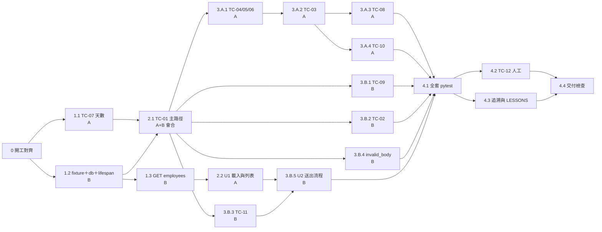

# 07 工作分配計畫 — 票 001 兩人並行

> 版本：v0.1｜負責人：ChristingChang（PM）｜日期：2026-10-28｜狀態：**已確認（2026-10-28 小組決議，見文末）**
> 範圍：`issues/001-submit-leave.md`（000 已完成：`pytest` 2 passed）。契約來源：`docs/05-sds.md`、`docs/06-test-plan.md`。
> 本檔只排「先後順序與依賴」，不排時鐘時間。

## 角色

| 代號 | 角色 | 擁有的檔案（只有擁有者可改） |
|---|---|---|
| **A** | 規則線工程師 | `backend/app/leave_rules.py`、`backend/tests/unit/test_leave_rules.py`、`static/` 下的列表與載入部分（U1） |
| **B** | 資料線工程師 | `backend/app/db.py`、`api.py`、`main.py`、`backend/tests/conftest.py`、`static/` 下的送出流程（U2） |
| 共用 | 兩人 | `backend/tests/acceptance/test_submit_leave.py`：各自**只新增**自己 TC 的測試函式，不改對方的 |

可以並行的前提：SDS 已經把 `leave_rules`／`db`／`api` 的函式簽名和 API 本文都定好了，兩人照契約各寫各的，不必等對方的程式。

## WBS（第一層＝階段，第二層＝工項）

「完成」欄由 PM 依工程師回報的證據打勾（`[x]`）；沒有證據不打勾。「波次」代表先後順序：同一波次的工項可以同時做；後一波要等「前置」列出的工項完成。

| 完成 | WBS | 工項 | 負責 | 波次 | 前置 | 完成條件 |
|---|---|---|---|---|---|---|
| [ ] | **0** | **開工對齊** | A+B | 0 | — | 兩人都確認下面三項 |
| [ ] | 　0.1 | 確認檔案擁有權與 SDS 函式簽名 | A+B | 0 | — | 兩人都同意本表的「擁有的檔案」欄 |
| [ ] | 　0.2 | 確認共用的測試基底（合法請求、員工 ID） | A+B | 0 | — | 合法基底的 6 個欄位值寫進 0.1 的共識 |
| [ ] | **1** | **地基（並行）** | | 1 | 0 | 1.1～1.3 都完成 |
| [ ] | 　1.1 | TC-07 天數算法：`count_leave_days`、常數、`ValidationResult` | A | 1 | 0 | 6 個邊界先看到預期原因的紅燈，**停下讓小組確認第一個紅燈**，再轉綠；`leave_rules.py` 沒有 import `sqlite3`／`os` |
| [ ] | 　1.2 | 暫存資料庫 fixture、`db.py`（建表、種子、連線）、`main.py` lifespan | B | 1 | 0 | fixture 用 `tmp_path`；`init_db` 跑兩次不報錯，員工仍是 3 位；測試跑完 `backend/data/leavebot.db` 沒有被建立或修改 |
| [ ] | 　1.3 | API-02 `GET /api/employees`（TC-09 步驟 1） | B | 1 | 1.2 | 先紅後綠：依序回 E001、E002、E003 |
| [ ] | **2** | **主路徑接縫（兩人會合）** | | 2 | 1 | 2.1 完成 |
| [ ] | 　2.1 | TC-01 主路徑：`validate_leave_request` 快樂路徑（A）＋ POST、`insert_leave`、`GET …/leaves`（B） | A+B | 2 | 1.1、1.2 | TC-01 先紅後綠：201、`days = 2`、`pending`、新開 client 讀回仍在 |
| [ ] | 　2.2 | U1 畫面：載入員工、未選時停用、選員工後顯示列表 | A | 2 | 1.3 | 依 UI-01「載入」「選員工」兩段手動檢查通過；文字全用 `textContent` |
| [ ] | **3** | **規則與資料分頭補齊（並行）** | | 3 | 2.1 | 3.A、3.B 都完成 |
| [ ] | 　**3.A** | **規則線：拒絕案例** | A | 3 | 2.1 | 3.A.1～3.A.4 都綠燈，每個拒絕案例都斷言筆數不變 |
| [ ] | 　　3.A.1 | TC-04 反向日期、TC-05 半天跨日、TC-06 只有週末 | A | 3 | 2.1 | 三個 TC 各自先紅後綠；422 且筆數 0 |
| [ ] | 　　3.A.2 | TC-03 必填／合法值／員工存在／日期格式／多重錯誤 | A | 3 | 3.A.1 | 子案例 a～e 都綠燈；e 同時含兩個錯誤 |
| [ ] | 　　3.A.3 | TC-08 拒絕 `status`、`days`、`foo` | A | 3 | 3.A.2 | 三個都回 422，筆數 0 |
| [ ] | 　　3.A.4 | TC-10 理由規則（單元 6 條＋API 2 條） | A | 3 | 3.A.2 | 上限只出現在 `REASON_MAX_LENGTH`；SQL 片段原樣讀回 |
| [ ] | 　**3.B** | **資料線：列表、故障與本文格式** | B | 3 | 2.1 | 3.B.1～3.B.5 都完成 |
| [ ] | 　　3.B.1 | TC-09 員工隔離、未知員工 404 | B | 3 | 2.1 | 查詢含 `WHERE employee_id = ?`；E999 回 404 |
| [ ] | 　　3.B.2 | TC-02 半天 0.5、過去日期、新的在前 | B | 3 | 2.1 | 列表順序 b 在前、a 在後 |
| [ ] | 　　3.B.3 | TC-11 資料庫故障回 500 | B | 3 | 2.1 | 替換 `db.insert_leave` 後回 500 `database_error`，訊息不含例外細節，筆數 0 |
| [ ] | 　　3.B.4 | `invalid_body`：本文不是 JSON 物件回 400 | B | 3 | 2.1 | 先在 `docs/06-test-plan.md` TC-03 補子案例 f（非 JSON、JSON 陣列），經小組確認後才寫測試；先紅後綠，回 400 `invalid_body` 且筆數 0 |
| [ ] | 　　3.B.5 | U2 畫面：送出中停用、成功訊息與清空、錯誤逐條顯示、500 提示 | B | 3 | 2.2、3.B.3 | 依 UI-01「送出中」「成功」「驗證失敗」「伺服器失敗」四段手動檢查通過 |
| [ ] | **4** | **合流驗收** | A+B | 4 | 3 | 4.1～4.4 都完成 |
| [ ] | 　4.1 | 全套 `pytest` | A+B | 4 | 3.A、3.B | 實際輸出貼進 `docs/06-test-plan.md` 追溯表，附日期 |
| [ ] | 　4.2 | TC-12 人工 8 步驟 | A 操作、B 記錄 | 4 | 4.1、3.B.5 | 證據放 `docs/evidence/`，檔名含 TC 編號與日期 |
| [ ] | 　4.3 | 追溯抽查與 LESSONS | A+B | 4 | 4.1 | 至少一條 AC → FR → API → TC → 結果抽查過；偏差寫進 `docs/LESSONS.md` |
| [ ] | 　4.4 | 交付檢查 | B | 4 | 4.2、4.3 | `git status`／`git diff` 只有本票檔案；不 commit，等小組驗收 |

## DAG

**關鍵路徑：** 0 → 1.1／1.2 → **2.1** → 3.A.1 → 3.A.2 → 3.A.3／3.A.4 → 4.1 → 4.2 → 4.4。
規則線（3.A）是最長的一條；B 做完 3.B 後若有空，可以接 4.2 的環境準備，或與 A 結對審 3.A 的測試。

**為什麼這樣切：**
- 按 SDS 的模組接縫切：A 只碰純函式 `leave_rules`，B 只碰 SQLite 與路由，改到同一個檔案的機會最小。
- 2.1 是唯一的硬性會合點：主路徑同時需要規則與資料庫，兩人一起寫，避免各自假設對方的介面。
- 2.1 之後，拒絕類 TC（只動規則）和列表／故障類 TC（只動資料與路由）彼此獨立，可以完全並行。
- 畫面拆成 U1／U2：U1 只依賴 GET employees，A 可以在等 2.1 時先做，把等待時間用掉。

## 小組決議（2026-10-28）

1. **工作目錄：** 兩人共用同一個工作目錄，不開 worktree。開發中各自用 `.venv/bin/python -m pytest -k <TC>` 只跑自己的 TC，到 4.1 才跑全套。
2. **一跑就綠的 TC：** 2.1 只寫 TC-01 需要的最少程式。若某 TC 第一次就綠，暫時拿掉對應程式，確認測試會因預期原因變紅，再放回來，並記進 `docs/LESSONS.md`。
3. **共用測試檔：** 兩人都在 `test_submit_leave.py` 新增測試，只新增自己 TC 的函式，不改對方的。
4. **`invalid_body`（400）：** 歸 B，列為 3.B.4。目前 Test Plan 沒有對應案例，B 先提出 TC-03 子案例 f 的修訂，小組確認後才寫測試。
5. **進度落後：** 落後 15 分鐘就找講師。要延後時，先延後 3.A.4 的 API 部分或 3.B.2；TC-01、TC-04～TC-06、TC-11 不延後。延後的 TC 在追溯表標「未執行」並寫明原因。
